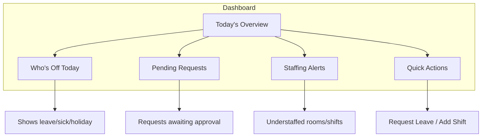

# Dashboard Help

## What It Does

Your command center showing everything happening today - who's off, who's working, and what needs your attention.

## Why It Matters

Start each day knowing exactly what's going on without clicking through multiple screens. See at a glance if any rooms are understaffed or if there are leave requests waiting for approval.

## How To Use It

1. **Check "Today's Overview"** - See who's working and who's off
2. **Review "Pending Requests"** - See any leave requests needing your approval
3. **Check "Staffing Alerts"** - Spot any coverage gaps
4. **Use "Quick Actions"** - Request leave or add a shift with one click

## Visual Diagram

## Common Questions

### What do the different colors mean?

Green indicates everything is covered. Yellow means there might be a potential issue. Red shows urgent items needing attention, like understaffed shifts.

### How often does the dashboard update?

The dashboard refreshes automatically every few minutes, or you can pull down to refresh manually on mobile.

## Tips

- The dashboard is your best starting point each morning
- Click on any widget to drill down into more details
