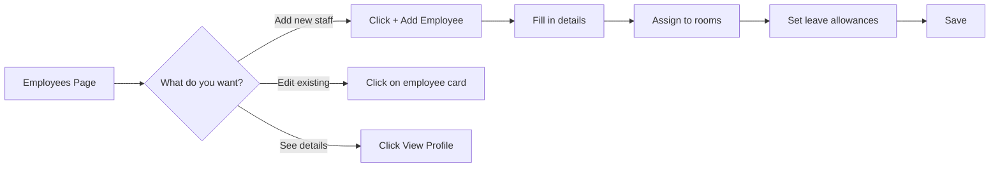

# Employees Help

## What It Does

Add, edit, and manage your team members - their details, roles, and which rooms they can work in.

## Why It Matters

Accurate employee records are the foundation of scheduling. Get this right, and everything else flows smoothly - from leave balances to roster assignments.

## How To Use It

1. Click **"+ Add Employee"** to add a new team member
2. Fill in their **name, email, and contact details**
3. Set their **role** (Manager or Employee)
4. Assign them to the **rooms they can work in**
5. Set their **annual leave allowances**
6. Click **"Save"** to create the profile

## Visual Diagram

## Fields Explained

- **Name & Email**: How they'll appear and log in
- **Role**: Manager (approves leave) or Employee (requests leave)
- **Rooms**: Where they can be scheduled to work
- **Leave Allowances**: How many days off they get per year

## Common Questions

### What's the difference between Manager and Employee roles?

Managers can approve/deny leave requests, build rosters, and access the payroll export. Employees can only request leave and view their own schedule.

### Can someone work in multiple rooms?

Yes! When assigning rooms, you can select multiple rooms. This means they can be scheduled to work in any of their assigned rooms.

### How do I remove an employee who has left?

Click on their profile and use the "Archive" option. This keeps their historical data but removes them from active scheduling.

## Tips

- Double-check email addresses - staff will use these to log in
- Assign rooms before trying to schedule someone
- Review leave allowances at the start of each year
