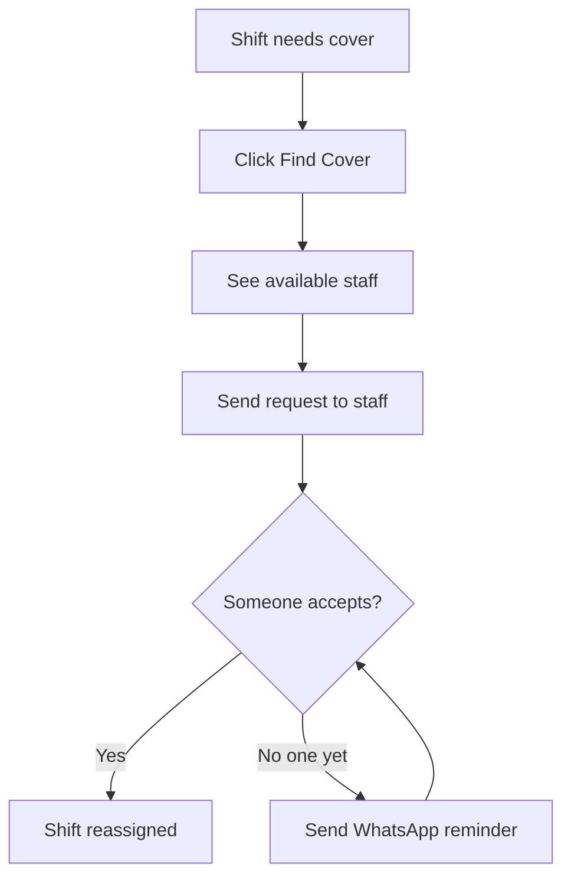

# Find Cover Help

{: .note }
This page has not been checked against the current app yet. The pages listed under [Page by page]({{ site.baseurl }}/docs/app/) as checked are up to date.

## What It Does

When someone can't work their shift, quickly find an available replacement from your team.

## Why It Matters

Emergencies happen. Find Cover helps you fill gaps fast without endless phone calls or WhatsApp messages.

## How To Use It

1. From a shift, click **"Find Cover"**
2. See which **staff are available**
3. **Send a cover request** to one or more people
4. **Wait for responses**
5. **Confirm the replacement**

## Visual Diagram

## Common Questions

### How do staff respond to cover requests?

They'll get a WhatsApp message or notification. They can accept or decline directly.

## Tips

- Send requests to multiple people for faster responses
- Check who's qualified for the room first
