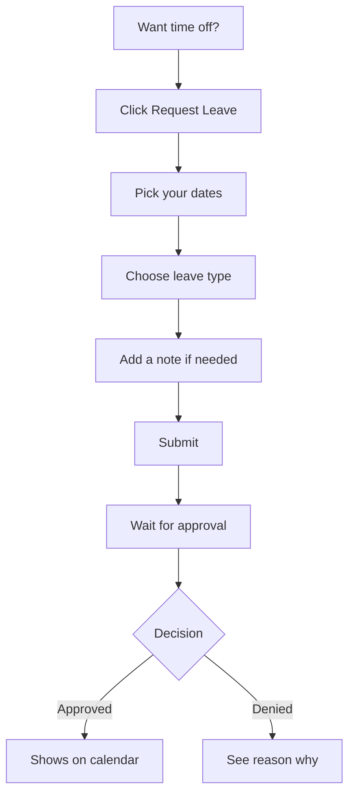
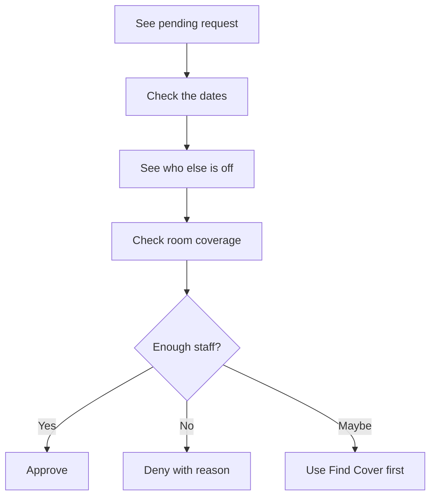

# Leave Requests Help

## What It Does

The place where time-off requests are made, reviewed, and decided. Staff submit requests here, and managers approve or deny them.

## Why It Matters

Fair, transparent leave management keeps everyone happy and ensures the schedule stays covered. No more sticky notes or forgotten requests.

## How To Use It

### For Staff - Requesting Leave

1. Click **"Request Leave"** to submit a new request
2. Select the **dates** you need off
3. Choose the **leave type** (Annual, Sick, etc.)
4. Add a **note** explaining why (optional but helpful)
5. **Submit** and wait for your manager's decision

### For Managers - Approving Leave

1. See the list of **pending requests**
2. **Check the dates** requested
3. **Review who else is off** (use wallchart)
4. **Check room coverage**
5. **Approve or Deny** with a reason

## Visual Diagrams

### Staff Request Flow

### Manager Approval Flow

## Common Questions

### How long does approval take?

Managers are notified immediately when you submit a request. Approval time depends on your manager, but most are processed within 24-48 hours.

### Can I cancel a leave request?

You can cancel pending requests before they're approved. Once approved, you'll need to contact your manager to cancel.

### What if my request is denied?

Your manager must provide a reason. You can submit a new request for different dates or discuss alternatives with your manager.

## Tips

- Request leave as early as possible for better chances of approval
- Check the wallchart first to see who else is off on your dates
- Managers: Always provide a reason when denying requests
