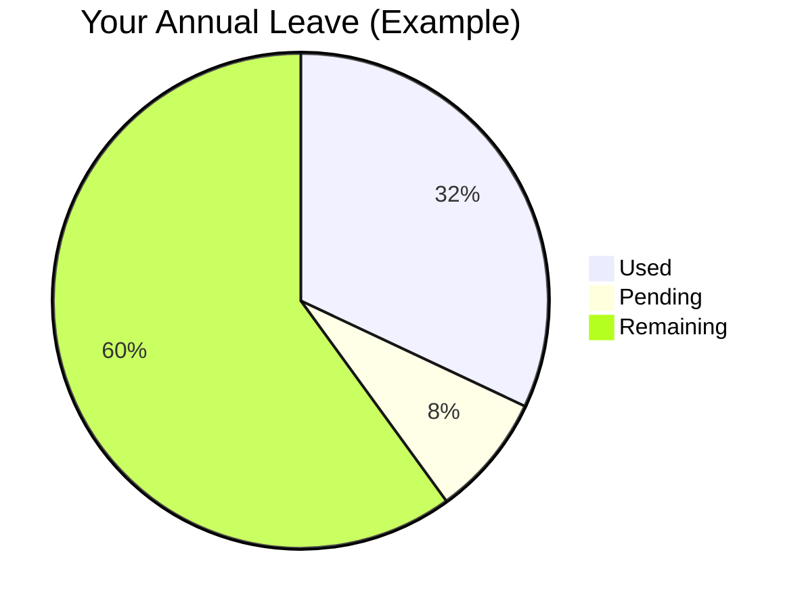

# My Leave Help

{: .note }
This page has not been checked against the current app yet. The pages listed under [Page by page]({{ site.baseurl }}/docs/app/) as checked are up to date.

## What It Does

Your personal leave hub - see your balances, history, and upcoming time off at a glance.

## Why It Matters

Know exactly how much leave you have left and plan your time off confidently. No more guessing or asking HR.

## How To Use It

1. **Check your leave balance** at the top of the page
2. See **"Used"** days (already taken), **"Pending"** (requested but not approved), and **"Remaining"**
3. View your **leave history** below
4. Click on any past request to see details

## Visual Diagram

## Understanding Your Balances

- **Used**: Days already taken
- **Pending**: Requested but not yet approved
- **Remaining**: Available to request

## Common Questions

### Why does my balance show pending days?

Pending days are requests you've submitted but haven't been approved yet. Once approved, they'll move to "Used".

### When does my balance reset?

Leave balances typically reset at the start of the leave year, which your organization defines (usually January 1st or April 1st).

### Can I carry over unused leave?

If your organisation has set a carry-over rule, the **Carry days into next year** card lets you ask before the year ends. Days not carried with approval expire. See [Carry-over]({{ site.baseurl }}/docs/app/carry-over/).

## Tips

- Check your balance before planning holidays
- Pending requests count against your available balance
