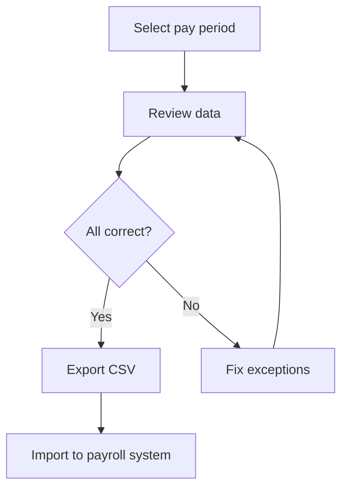

# Payroll Help

## What It Does

Export attendance and time-off data ready for your payroll system.

## Why It Matters

Accurate payroll data means people get paid correctly, on time, every time. No manual calculations needed.

## How To Use It

1. Select the **pay period** (dates)
2. **Review** the summary of hours and absences
3. Check for any **exceptions or flags**
4. **Resolve** any discrepancies
5. Click **"Export"** to download the CSV file
6. Import the file into your **payroll system**

## Visual Diagram

## Common Questions

### What format is the export?

We export CSV files that work with most payroll systems including Collsoft. Contact us if you need a specific format.

### What are exceptions?

These are items that need manual review - like missing clock-ins, overlapping shifts, or unusual hours.

## Tips

- Export payroll a day or two before the deadline
- Review exceptions before exporting
- Keep exported files for your records
