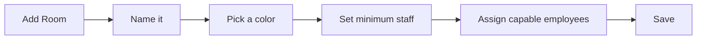

# Rooms Help

{: .note }
This page has not been checked against the current app yet. The pages listed under [Page by page]({{ site.baseurl }}/docs/app/) as checked are up to date.

## What It Does

Define and manage your physical work areas - classrooms, sections, stations, or whatever you call them.

## Why It Matters

Each room can have different staffing requirements. Setting these up means Timebreez can warn you when you're short-staffed.

## How To Use It

1. Click **"+ Add Room"** to create a new room
2. Give it a **name** that staff will recognize
3. Pick a **color** for easy identification on the roster
4. Set the **minimum staff** required
5. Assign **capable employees** to this room
6. **Save** the room configuration

## Visual Diagram

## Common Questions

### What does "minimum staff" mean?

The minimum number of people needed to safely operate that room. If scheduling falls below this, you'll see a warning.

### Can an employee work in multiple rooms?

Yes! Assign them to all rooms they're qualified to work in. They can then be scheduled in any of those rooms.

## Tips

- Use consistent naming (e.g., "Baby Room" not "BR")
- Choose distinct colors for each room
- Set realistic minimum staffing levels
