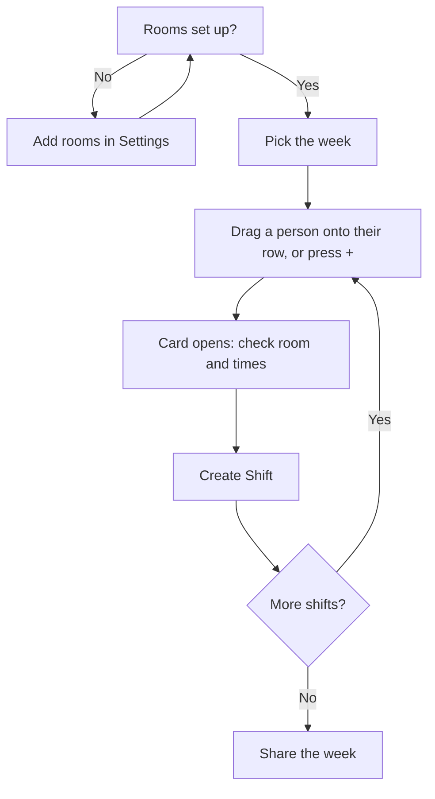
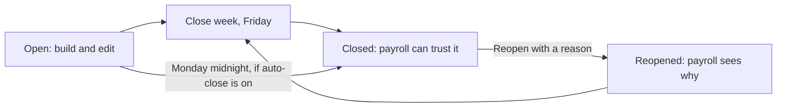

# Roster

**Who uses it:** admins and managers. In the menu: **Roster**.

Build the week: put each person in a room, on a day, at set times. Rooms need the right number of staff all day. The roster is where you plan that, and it is what staff see in My Schedule.

## The views

| View | Shows |
|---|---|
| **By Staff** | One row per person, one column per day of the week |
| **By Room** | One row per room, so you can see each room's cover |
| **Timeline** | One room on one day, hour by hour. Pick the room and the date |

Move between weeks with the arrows. On any other week, **Back to this week** takes you to the current one. A one-line how-to sits above **By Staff**.

## Before the first week

1. Add your rooms in **Settings, Rooms**. Every shift belongs to a room, so with no rooms nothing can be saved. The roster shows an **Add your rooms first** banner until you do.
2. Give each person a **home room** on their staff profile. New shifts for them then pick that room for you.

## Building the week

1. Pick the week with the arrows at the top. **Fill from Last Week** starts you from last week's shifts. If this week already has shifts you choose **Add to existing shifts** or **Replace all existing shifts**. Copying never overwrites unless you choose Replace. See [Fill from Last Week](#fill-from-last-week) for what it copies and what it leaves out.
2. In **By Staff**, press **+** in a person's cell for that day, or open **Staff Availability** on the left and drag them onto a day in their own row.
3. A **Create Shift** card opens. Nothing is saved yet. The room is their home room if they have one; change it if they work elsewhere that day.
4. The times start at 7:30am to 4:30pm. That is a suggestion only, not the person's own pattern. Set the shift they will actually work, then press **Create Shift**.
5. Click a shift to change it, drag it to another day to move it, or hover and press the red **x** to remove it.
6. Press **Share** to send the week. You can copy the picture or a link, download it, or send it with the messaging apps your organisation switched on in **Settings, Messaging** (Telegram, Slack or Teams). See [Share the week](#share-the-week).

There is no Publish button. A shift shows in the person's [My Schedule]({{ site.baseurl }}/docs/app/my-schedule/) as soon as you create it. When the week is over and the roster matches what really happened, [close the week](#close-the-week).

**Autofill** shows how many gaps the week has. Pressing it opens a preview of proposed assignments for understaffed rooms; nothing changes until you apply them.

## Close the week

**Close week** tells payroll the roster for that week is final. Do it on Friday, once the roster matches what really happened (sick days, swaps, early finishes).

1. Pick the week. Next to the week it says **Not closed yet**. **Close week** is the one filled button on the page; **Share** and **Export** are outline buttons.
2. Press **Close week**, then **Close week** again on the card.
3. It now says, for example, **Closed by Mary Murphy, Fri 11 Dec 15:42**. Payroll sees the same words.

A closed week is locked. Adding, changing, moving or removing a shift is refused with a message, and **Fill from Last Week** and **Autofill** are hidden for that week.

### Changing a closed week

1. Press **Reopen** next to it.
2. Say why, for example "Mary was out sick Tuesday". You can't reopen without a reason.
3. Make the changes, then press **Close week** again.

Payroll sees the reopen, who did it, when and the reason. If a shift in a closed week changes any other way (for example a leave approval cancels it), it is not blocked, but payroll sees a red line saying what changed, who changed it and when.

### Close the week automatically

An admin can turn on **Close the week automatically when the new week starts** in **Settings, Scheduler**. At midnight on Monday (in the time zone set there, Europe/Dublin unless you change it) last week closes itself if nobody closed it. The chip then says **Closed automatically**. A week someone reopened is never closed automatically; a person has to close it. It is off until an admin turns it on.

## Fill from Last Week

It copies last week's shifts onto the same days this week, and then lists everything it did not copy and why.

- **Leave last week:** a shift that was cancelled because the person was on leave last week is copied back. They are working this week.
- **Leave this week:** a person on approved leave this week does not get that shift. The list names them.
- **Closed days:** days you are closed this week, and public holidays, are left empty. The list says which days. If you open on public holidays, turn on **We open on public holidays** in **Settings, Operating Hours**. To open on one holiday only, add it there as altered hours.
- **People who have left** are not copied.
- **Shifts already there** are not added twice, so pressing it again is safe.

The panel is green when everything was copied and amber when something was left out.

**Example.** Last week Mary Murphy was on leave on Friday, so her Friday shift was cancelled. This week she is working, and Monday is a public holiday. Fill from Last Week copies her Friday shift back and leaves Monday empty for everyone, with a line saying so.

## A shift on a leave day

If you create, edit or add a cover shift for someone with approved leave that day, a warning says a shift saved on that day stays on the rota and is paid as worked, on top of the leave. You can only save after ticking **They are working this day anyway**. Dragging a shift onto someone's leave day is refused, with the reason.

If Timebreez cannot check the person's leave for that day, Add Shift, Edit Shift and Add Cover say "Couldn't check this person's leave for this day. Check the leave calendar before saving." It does not mean they have no leave.

## Share the week

**Share** opens a picture of the week. Choose **Full roster (all rooms)** or **Room-by-room**.

- **Copy image**, **Copy link** and **Download** work for everyone.
- **Send to Telegram group** opens Telegram so you can pick the staff group. **Send to Slack** and **Send to Teams** post to the staff channel set up in Settings. These buttons work as soon as Share opens; you do not need to press Copy link first.
- You only see the apps an admin switched on in **Settings, Messaging**. If none is on, Share says **Choose your messaging app in Settings → Messaging**.

## Rooms in By Room

Each room's name shows its ratio and how many children it holds, for example **up to 9**. Hover it to see why: "Room holds up to 9 children. At 1:3 that needs 3 staff." Click the room name to open that room's settings.

Each day cell reads, for example, **4 on / 3 needed**. Hover it for the reason, for example "9 children at 1:3 needs 3 staff. 4 rostered: 1 spare." Cancelled and no-show shifts are not counted, and nobody is counted twice. People who have left are not shown.

| Status | Means |
|---|---|
| OK | Enough staff for the ratio and the number of children |
| Min | Exactly the staff the ratio needs, with no spare person for breaks or sickness |
| Under | Fewer staff than the ratio needs. Add staff to this room |
| Not set (grey) | The room has no number of children, so cover can't be checked. Click the room name to set it |

A room that is **Not set** is not counted as compliant, and the banner says how many rooms can't be checked.

To take someone off a day, press the **×** on their chip, or drag the chip onto the **Drop here to take Mary Murphy off** strip that shows while you drag. A person can't be moved onto a day they already work.

## Locked cells

| Cell | Why it is locked |
|---|---|
| Shaded grey | The day has passed. You can still add or change shifts there until the week is closed, so the roster matches what really happened. Once the week is closed, press Reopen and say why. |
| A leave type's name, such as Annual Leave or Sick Leave | The person is on leave that day. The cell uses that leave type's colour from Settings, the same as the wallchart. A type with no colour shows green for paid and light green for unpaid. Change or cancel the leave first if that's wrong. |
| Any cell in a closed week | The week is closed. Press **Reopen** and give a reason first. |

Hover any locked cell to see the reason.

## Who's actually in today

If an admin has switched on **Show who's actually in** (on the Paxton door setup page), today's shifts on the roster carry a small mark from the door and clock swipes:

| Mark | Means |
|---|---|
| **in 08:02** (green) | Clocked in at that time |
| **gone 16:35** (grey) | Clocked out |
| **on site 07:55, not clocked in** | Swiped the door but has not clocked in |
| **not in · 12 min late** (orange) | Shift has started and there is no swipe |
| **due 09:00** | Shift has not started yet |

Hover a mark to read it in full. The marks only show information: the rota, no-show marking and pay are not changed. Past and future days show no marks.

Approving or cancelling leave now shows on the roster straight away, without reloading the page.

## Availability

The **Staff Availability** panel lists who is free. Search by name, or press **Show Available Only**. Click a name to see that person's week.

Each card shows **FT** or **PT**, worked out from the person's contracted hours against your full-time day in [Settings]({{ site.baseurl }}/docs/app/settings/#leave-calculation-rules) times 5. If Timebreez doesn't know, it shows **?**, never a guess. A QQI badge shows only when a qualification is recorded.

The **Cover Pool** shows today when today is in the week you are looking at. Drag a person from Staff Availability onto the Cover Pool to add them as cover for that day.

## Make the week wider

- **Hide menu** (the button at the top of the main menu, on a computer) folds the main menu away. **Show menu** brings it back.
- **Staff Availability** folds to a narrow strip on the left. Press it to open the panel again. In **By Staff** it starts folded, because each row is already a person. In **By Room** it starts open.
- **Cover Pool** folds the same way. It folds by itself when nobody is available, and the strip shows 0.

Each choice is remembered in this browser. The roster also remembers whether you last used By Staff, By Room or Timeline.

## Coverage warnings

If a room falls below the staff it needs, a warning shows on the roster. The warnings and the count start from today; days already gone are left out. Fix it before the day, or the same warning appears when someone's leave is approved.

## Someone leaves early or doesn't turn up

Click their shift to open **Edit Shift**. Under **Need cover?**:

- **Leaving early:** move the end time earlier. Press **Save and find cover 15:00-18:00** (the times are the part they won't work). The shift is shortened and cover is asked for the rest.
- **Didn't turn up:** press **Mary Murphy didn't turn up: find cover**. The shift is marked as a no-show and cover is asked for the whole shift.

Timebreez asks up to 3 free people on Telegram. Free means they are active, have no approved or pending leave that day, and have no shift at the same time. Cover staff are asked first, then people who worked in that room in the last 4 weeks. Only people who have [linked Telegram]({{ site.baseurl }}/docs/app/my-settings/#link-telegram) can be asked.

Each person gets **Yes, I'll cover** and **Can't** buttons. The first Yes gets a cover shift in that room. The others are told it's covered, and you are told who is coming, on Telegram and in the inbox. If everyone says Can't, you are told that too.

## Common questions

### Why can't I drop someone on a day?

Hover the cell to see why. Days before today are locked. A person on leave that day shows their leave type and can't be dropped there; to give them a shift anyway, see [A shift on a leave day](#a-shift-on-a-leave-day). In By Staff, a person can only go on their own row. With no rooms set up, no shift can be saved. Help (the **?**) also tells you why.

### Why can't I change a shift last week?

The week is probably closed: the chip next to the week says who closed it. Press **Reopen**, say why, make the change and close it again. See [Changing a closed week](#changing-a-closed-week).

### Why does it ask me for a room?

Every shift belongs to a room, because room ratios depend on it. Give each person a home room on their staff profile and it is chosen for you.

### Where do the 7:30 to 4:30 times come from?

They are a starting suggestion, not the person's own pattern. Always set the real shift times before saving.

### Where do messages appear?

Confirmations and errors show as a message on the screen, not a browser pop-up.

## Help panel

Open Help on the roster and it tells you what to do next for the week you are looking at, for example whether rooms or home rooms are missing, with links to fix them.

See also [Who does what each week]({{ site.baseurl }}/docs/app/weekly-jobs/).
