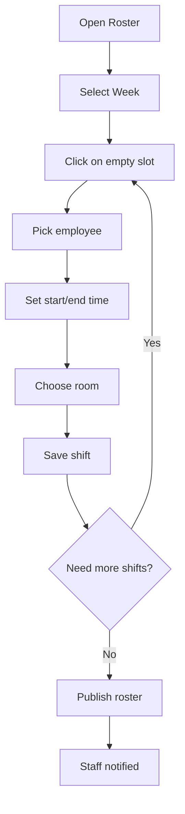

# Roster Help

## What It Does

Build and manage work schedules - assign people to shifts, rooms, and time slots.

## Why It Matters

The right people in the right place at the right time. Good scheduling means smooth operations and happy staff.

## How To Use It

1. Select the **week** you want to schedule
2. Click on an **empty slot** to add a shift
3. Select the **employee** from available staff
4. Set the **start and end time**
5. Choose which **room** they'll work in
6. **Save** the shift
7. When complete, click **"Publish"** to notify staff

## Visual Diagram

## Common Questions

### What happens when I publish the roster?

Staff will be notified about their shifts via WhatsApp and email. They can then see their schedule in the app.

### Can I change a shift after publishing?

Yes, but affected staff will be notified of the change. Try to finalize schedules before publishing.

### Why can't I schedule someone?

They might not be assigned to that room, or they may have approved leave on that day. Check their profile and the wallchart.

## Tips

- Build rosters at least a week in advance
- Check approved leave before scheduling
- Use "Find Cover" when someone calls in sick
