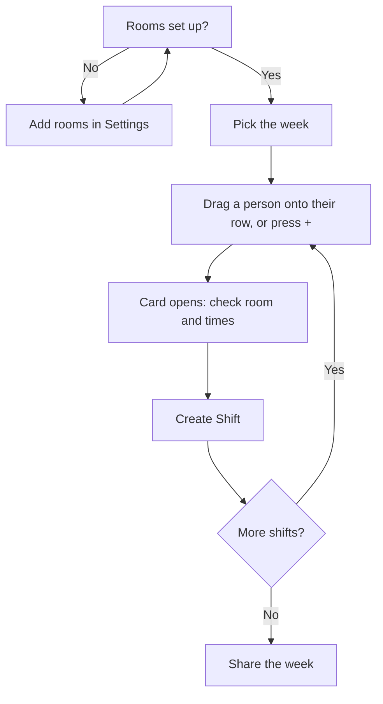

# Roster

**Who uses it:** admins and managers. In the menu: **Roster**.

Build the week: put each person in a room, on a day, at set times. Rooms need the right number of staff all day. The roster is where you plan that, and it is what staff see in My Schedule.

## The views

| View | Shows |
|---|---|
| **By Staff** | One row per person, one column per day of the week |
| **By Room** | One row per room, so you can see each room's cover |
| **Timeline** | One room on one day, hour by hour. Pick the room and the date |

Move between weeks with the arrows, or press **This Week**. A one-line how-to sits above **By Staff**.

## Before the first week

1. Add your rooms in **Settings, Rooms**. Every shift belongs to a room, so with no rooms nothing can be saved. The roster shows an **Add your rooms first** banner until you do.
2. Give each person a **home room** on their staff profile. New shifts for them then pick that room for you.

## Building the week

1. Pick the week with the arrows at the top. **Fill from Last Week** starts you from last week's shifts. If this week already has shifts you choose **Add to existing shifts** or **Replace all existing shifts**. Copying never overwrites unless you choose Replace.
2. In **By Staff**, drag a person from **Staff Availability** onto a day in their own row, or press **+** in that cell.
3. A **Create Shift** card opens. Nothing is saved yet. The room is their home room if they have one; change it if they work elsewhere that day.
4. The times start at 7:30am to 4:30pm. That is a suggestion only, not the person's own pattern. Set the shift they will actually work, then press **Create Shift**.
5. Click a shift to change it, drag it to another day to move it, or hover and press the red **x** to remove it.
6. Press **Share** to send the week by WhatsApp, email or a link.

There is no Publish button. A shift shows in the person's [My Schedule]({{ site.baseurl }}/docs/app/my-schedule/) as soon as you create it.

**Autofill** shows how many gaps the week has. Pressing it opens a preview of proposed assignments for understaffed rooms; nothing changes until you apply them.

## Locked cells

| Cell | Why it is locked |
|---|---|
| Grey with a lock | The day has passed. You can't add shifts to a day that's gone. |
| HOLS, UNPAID or OFF | The person is on leave that day. Change or cancel the leave first if that's wrong. |

Hover any locked cell to see the reason.

## Availability

The **Staff Availability** panel lists who is free. Search by name, or press **Show Available Only**.

## Coverage warnings

If a room falls below the staff it needs, a warning shows on the roster. Fix it before the day, or the same warning appears when someone's leave is approved.

## Common questions

### Why can't I drop someone on a day?

Hover the cell to see why. Days before today are locked. A person on leave that day can't be rostered. In By Staff, a person can only go on their own row. With no rooms set up, no shift can be saved. Help (the **?**) also tells you why.

### Why does it ask me for a room?

Every shift belongs to a room, because room ratios depend on it. Give each person a home room on their staff profile and it is chosen for you.

### Where do the 7:30 to 4:30 times come from?

They are a starting suggestion, not the person's own pattern. Always set the real shift times before saving.

### Where do messages appear?

Confirmations and errors show as a message on the screen, not a browser pop-up.

## Help panel

Open Help on the roster and it tells you what to do next for the week you are looking at, for example whether rooms or home rooms are missing, with links to fix them.
