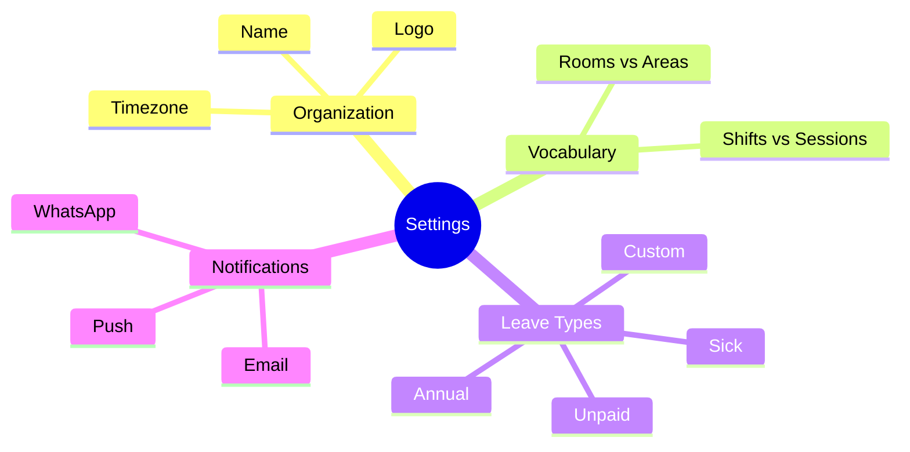

# Settings Help

## What It Does

Configure your organization's preferences - terminology, leave types, and business rules.

## Why It Matters

Make Timebreez work the way your business works. Customize labels, set up leave policies, and configure notifications.

## How To Use It

1. Navigate to the **setting** you want to change
2. Update the **values** as needed
3. **Save** your changes
4. Changes apply **immediately** across the system

## Visual Diagram

## Common Questions

### Can I change the terminology?

Yes! In vocabulary settings, you can change "Rooms" to "Areas", "Shifts" to "Sessions", and more.

### Do changes affect historical data?

Most changes only affect new data. Historical records remain unchanged to maintain accuracy.

## Tips

- Review settings when onboarding new staff
- Update leave allowances at the start of each year
