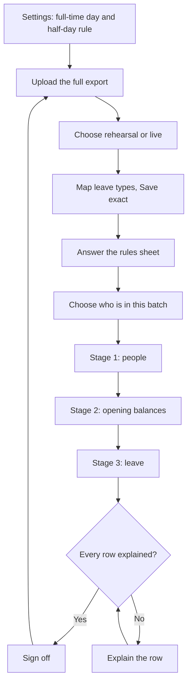

# Timetastic Import Help

## What It Does

Brings your staff, their allowances and their leave across from Timetastic in batches of people you choose, and checks every balance against Timetastic before you sign it off.

## Why It Matters

Balances are pay. Each batch goes through three stages (people, opening balances, leave), and every difference from Timetastic has to be explained before you can sign it off. Nothing wrong reaches payroll unnoticed.

## Before you start

1. In **Settings, Leave setup**, set the **Full-time working day**. For example, 8 hours 15 minutes is 495 minutes.
2. In the same place, set **What a half day costs**. Half of a 495-minute day is 247.5 minutes, which is not a whole minute. The rule says whether that becomes 247 (round down) or 248 (round up). Without it, those half days cannot be posted and the batch cannot be signed off. Set its **Effective from** on or before your earliest half-day booking, usually the start of the leave year. A half day is judged by the rule in force on the booking's date, so a rule that starts today does not cover a half day in August.

## How To Use It

1. In Timetastic, export your full data as Excel. The file has six sheets: Organisation, Departments, Users, Leave, Time in Lieu and Work Schedules.
2. Upload the **whole file, unchanged**, for every batch. Do not trim it to a few people and do not rename it.
3. **Analyze**: check what was found. Exact duplicate bookings are collapsed for you.
4. **Organization**: choose **New rehearsal** for your first practice batch and **Existing rehearsal** for every practice batch after it. Choose **Live organization** only for the real import.
5. **Staff gaps**: decide anyone who needs it, for example someone who already has a Timebreez login.
6. **Leave types**: map each Timetastic leave type. Use **Save exact** so the mapping carries to your next batch. **Create exact** makes a new leave type that is **unpaid** until you confirm paid or unpaid on [Leave Types]({{ site.baseurl }}/docs/app/leave-types/).
7. **Import plan**: answer the **import rules sheet** (leave year, full-time day, part-time day lengths, carry-over, service and discretionary days). Write names exactly as Timetastic has them.
8. Choose who is in this batch. **Pick the next 5** ticks the next five people not yet imported. You can also tick people one by one, as many as you like, or press **Tick everyone not yet imported**. Then run the three stages:
   - **Stage 1, people**: check the names, choose "I have reviewed this list", and import them.
   - **Stage 2, opening balances**: press "Load from the rules sheet", then check and confirm each person's card. Each card starts with its next step: **1 thing to do** and the figure to confirm, or **Before you can confirm** and what is missing. Below the cards, **Working weeks** lists each person's working days from Timetastic's Work Schedules; press **Confirm N working weeks** so they can book leave. Hours staff are not proposed, because Timetastic does not say how many hours they work each day.
   - **Stage 3, leave**: run the leave import. Open every row that differs from Timetastic and explain it. Then, under **Which leave comes off the allowance**, confirm each imported leave type (see below).
9. **Sign off** the batch. For the next batch, upload the same full file again, choose the same organisation, and tick the next people. People already imported are shown and start unticked.

## Common Questions

### Do I need to cut the Excel file down to a few people?

No. Upload the full export every time and tick the people for this batch. A trimmed or renamed copy makes its own rehearsal, and later batches from the full file cannot join it.

### How many people should go in a batch?

You choose. Five is only the size of the **Pick the next 5** shortcut, not a limit. The trade-off: the batch is signed off as a whole, so one person with an unexplained difference holds up sign-off for everyone in it. Small batches keep a problem contained. We suggest 5 to 10 people at a time.

**Example.** You tick 8 people. Seven reconcile cleanly, but Mary Murphy has a row that differs from Timetastic. You cannot sign off the batch until her row is explained, even though the other seven are fine.

### A half day was not charged. What do I do?

The booking and the person's card say which date the Half day rule must cover. Open **Settings, Leave setup, Leave calculation rules**, set the Half day rule (round up or round down to the minute) with **Effective from** on or before that date, then press **Run the leave import again**. The re-run picks up half days an earlier run left out and charges them.

**Example.** Mary Murphy has a half day on 11 August. The Half day rule was saved with Effective from 16 November, so her card says it needs a rule in force on 11 August. Change Effective from to 1 January, run the leave import again, and the half day is charged.

### How is an allowance in days turned into minutes?

Days times the person's day length. If that is not a whole minute, your Half day rule rounds it, and the card shows both figures.

**Example.** Mary Murphy has 13.5 days and an 8h 15m day: 13.5 × 495 = 6,682.5 minutes, rounded up to 6,683 minutes by your Half day rule.

### Which leave types come off the allowance?

A leave type the import creates does not come off anyone's allowance until you confirm it. **Which leave comes off the allowance** (at the leave stage) shows each type with what Timetastic did with your own bookings of it, as a suggestion. Tick or untick **Comes off the allowance** and confirm each one, or press **Confirm all N as shown**. Do this after every import, the live one too. You can also confirm on [Leave Types]({{ site.baseurl }}/docs/app/leave-types/).

**Example.** Compassionate leave never came off the allowance in Timetastic, so it is suggested as not coming off. You confirm it, and a compassionate request is no longer checked against the person's balance.

### Someone's allowance is in hours. Are their bookings in days?

No. For someone whose Timetastic balance is in hours, each booking's Total Deducted is read in hours.

### What happens to a booking across the end of the leave year?

Once next leave year is open, a booking that crosses it is split. The part in each year comes off that year's allowance. The later part is dated from the first day of the new year. If the person has no confirmed working week, the charge is shared by working days Monday to Friday, less public holidays.

### Why does the rules sheet refuse a name?

It only accepts people who are in the uploaded file, spelled as in Timetastic. Write the full Timetastic name, not a nickname.

### The export has no carry-over. Where does it come from?

From you. Timetastic's export holds the organisation's carry-over cap, not what each person carried. List each person who carries leave over on the rules sheet.

### Why is someone one minute over?

Two half days rounded up to 248 minutes cost 496 minutes, one more than a 495-minute day. That follows from the half-day rule you chose.

The person's card says so. Each half-day booking carries a note such as "rounded up from 247.5 min by your half-day rule", and the card adds a summary such as "1 minute below zero from half days rounded up". That explains the difference from Timetastic, so you do not need to adjust anything.

**Example.** Mary Murphy has 495 minutes left in Timetastic and books two half days. Timebreez charges 248 + 248 = 496 minutes, so her balance shows 1 minute below zero, with both notes on her card.

### Can I import the same people again later (a top-up)?

Yes. Upload a newer export and answer **A top-up of people already imported** to the first question in Help. Re-running is safe. Each booking is matched by its Timetastic Booking Id:

- a booking that has not changed is skipped;
- a new booking is added;
- a booking that changed in Timetastic, for example one that was cancelled, is updated and its charge reversed.

**Example.** You re-run the same file: 0 created, 0 updated, every booking unchanged. If one 495-minute booking was cancelled in Timetastic since the first import, the re-run shows 1 updated and the person's balance goes up by 495 minutes.

You can tick only some of a batch you imported earlier. The people you leave unticked keep their figures and are not blocked at the leave stage.

### Why is Explain greyed out on a row?

The row is blocked by a question nobody has answered yet, so there is nothing to explain until it is answered. The row says which question it is and what answers it, and the screen says the figure cannot be explained while that stands.

**Day length.** If the row needs a day length, it lists each booking stated in days that needs one, with its date and figure. If the person's opening balance was confirmed in hours, it says so: an hours balance records no day length. Check those figures in Timetastic first. A booking cannot deduct more days than it spans, so a figure like that is not in days. Adding a day length to a confirmed opening balance is not built yet, so this row blocks sign-off until it is.

### I uploaded the file again and it says Live organization. Is that right?

Check it. A re-upload can default to Live organization. For practice batches choose **Existing rehearsal** and pick the rehearsal you made for your first batch.

## Tips

- Practise on a rehearsal until a batch reaches sign-off with every row explained, then do the same on the live organisation.
- The **Import journal** at the bottom of the page records every action, who did it and when.
