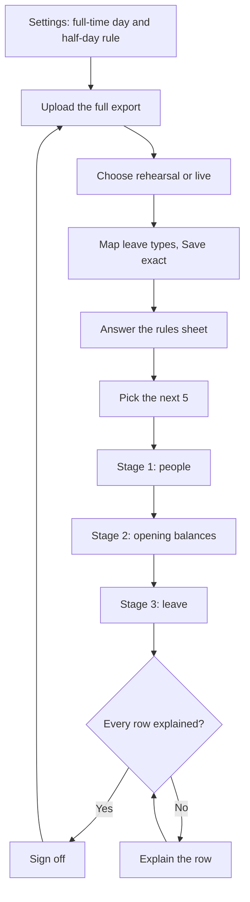

# Timetastic Import Help

## What It Does

Brings your staff, their allowances and their leave across from Timetastic, five people at a time, and checks every balance against Timetastic before you sign it off.

## Why It Matters

Balances are pay. Each batch goes through three stages (people, opening balances, leave), and every difference from Timetastic has to be explained before you can sign it off. Nothing wrong reaches payroll unnoticed.

## Before you start

1. In **Settings, Leave setup**, set the **Full-time working day**. For example, 8 hours 15 minutes is 495 minutes.
2. In the same place, set **What a half day costs**. Half of a 495-minute day is 247.5 minutes, which is not a whole minute. The rule says whether that becomes 247 (round down) or 248 (round up). Without it, those half days cannot be posted and the batch cannot be signed off. Set its **Effective from** on or before your earliest half-day booking, usually the start of the leave year. A half day is judged by the rule in force on the booking's date, so a rule that starts today does not cover a half day in August.

## How To Use It

1. In Timetastic, export your full data as Excel. The file has six sheets: Organisation, Departments, Users, Leave, Time in Lieu and Work Schedules.
2. Upload the **whole file, unchanged**, for every batch. Do not trim it to a few people and do not rename it.
3. **Analyze**: check what was found. Exact duplicate bookings are collapsed for you.
4. **Organization**: choose **New rehearsal** for your first practice batch and **Existing rehearsal** for every practice batch after it. Choose **Live organization** only for the real import.
5. **Staff gaps**: decide anyone who needs it, for example someone who already has a Timebreez login.
6. **Leave types**: map each Timetastic leave type. Use **Save exact** so the mapping carries to your next batch.
7. **Import plan**: answer the **import rules sheet** (leave year, full-time day, part-time day lengths, carry-over, service and discretionary days). Write names exactly as Timetastic has them.
8. Press **Pick the next 5**, then run the three stages:
   - **Stage 1, people**: check the names, choose "I have reviewed this list", and import them.
   - **Stage 2, opening balances**: press "Load from the rules sheet", then check and confirm each person's card.
   - **Stage 3, leave**: run the leave import. Open every row that differs from Timetastic and explain it.
9. **Sign off** the batch. For the next five, upload the same full file again, choose the same organisation, and press **Pick the next 5**.

## Common Questions

### Do I need to cut the Excel file down to a few people?

No. Upload the full export every time and press **Pick the next 5**. A trimmed or renamed copy makes its own rehearsal, and later batches from the full file cannot join it.

### A half day was not charged. What do I do?

The booking and the person's card say which date the Half day rule must cover. Open **Settings, Leave setup, Leave calculation rules**, set the Half day rule (round up or round down to the minute) with **Effective from** on or before that date, then press **Run the leave import again**. The re-run picks up half days an earlier run left out and charges them.

**Example.** Mary Murphy has a half day on 11 August. The Half day rule was saved with Effective from 16 November, so her card says it needs a rule in force on 11 August. Change Effective from to 1 January, run the leave import again, and the half day is charged.

### Why does the rules sheet refuse a name?

It only accepts people who are in the uploaded file, spelled as in Timetastic. Write the full Timetastic name, not a nickname.

### The export has no carry-over. Where does it come from?

From you. Timetastic's export holds the organisation's carry-over cap, not what each person carried. List each person who carries leave over on the rules sheet.

### Why is someone one minute over?

Two half days rounded up to 248 minutes cost 496 minutes, one more than a 495-minute day. That follows from the half-day rule you chose.

The person's card says so. Each half-day booking carries a note such as "rounded up from 247.5 min by your half-day rule", and the card adds a summary such as "1 minute below zero from half days rounded up". That explains the difference from Timetastic, so you do not need to adjust anything.

**Example.** Mary Murphy has 495 minutes left in Timetastic and books two half days. Timebreez charges 248 + 248 = 496 minutes, so her balance shows 1 minute below zero, with both notes on her card.

### Can I import the same people again later (a top-up)?

Yes. Upload a newer export and answer **A top-up of people already imported** to the first question in Help. Re-running is safe. Each booking is matched by its Timetastic Booking Id:

- a booking that has not changed is skipped;
- a new booking is added;
- a booking that changed in Timetastic, for example one that was cancelled, is updated and its charge reversed.

**Example.** You re-run the same file: 0 created, 0 updated, every booking unchanged. If one 495-minute booking was cancelled in Timetastic since the first import, the re-run shows 1 updated and the person's balance goes up by 495 minutes.

### I uploaded the file again and it says Live organization. Is that right?

Check it. A re-upload can default to Live organization. For practice batches choose **Existing rehearsal** and pick the rehearsal you made for your first batch.

## Tips

- Practise on a rehearsal until a batch reaches sign-off with every row explained, then do the same on the live organisation.
- The **Import journal** at the bottom of the page records every action, who did it and when.
