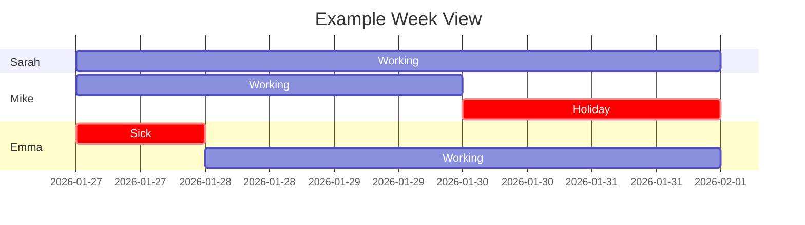

# Wallchart Help

{: .note }
This page has not been checked against the current app yet. The pages listed under [Page by page]({{ site.baseurl }}/docs/app/) as checked are up to date.

## What It Does

A visual calendar showing who's working, who's off, and when - across your whole team.

## Why It Matters

See the big picture at a glance. Spot coverage gaps before they become problems and plan around team absences.

## How To Use It

1. Use the **date picker** to navigate to different weeks or months. Picking a month or year opens that month from its 1st.
2. Each **row** shows one team member
3. **Colored blocks** show leave or shifts
4. **Click on any block** to see details
5. Use **filters** to show specific rooms or leave types

## What staff see

Staff do not see everyone's leave. They see **Team Coverage** for two weeks at a time (use the arrows to move two weeks back or forward) and a **My Leave** list with their own leave in those two weeks. If they have none, it says "No leave booked for this period".

## Visual Diagram

## Color Coding

- **Green**: Working/Scheduled
- **Blue**: Annual Leave
- **Yellow**: Sick Leave
- **Purple**: Training/Other
- **Red**: Understaffed Warning

## Common Questions

### What do the different colors mean?

Blue = Annual Leave, Yellow = Sick Leave, Green = Working/Scheduled, Purple = Training, and room-specific colors for shifts.

### Can I print the wallchart?

Yes! Use the print option from your browser menu, or export to share with the team.

## Tips

- Check the wallchart before approving leave to see coverage
- Use filters to focus on specific rooms when planning
- The wallchart updates in real-time as requests are approved
