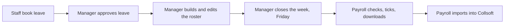

# Who does what each week

Three jobs keep the roster, leave and pay in step. In a small centre one person may do two of them. The names below are examples.

| Who | Example | Their week in one line |
|---|---|---|
| **Manager** (admin or manager) | Mary Murphy | Build the roster, keep it true to what happened, close the week on Friday |
| **Payroll** (admin) | John Byrne | Check the closed week on Payroll, tick each person, download the file, import it into Collsoft |
| **Staff** | Everyone | Book leave in the app or on Telegram; check your schedule |

## Manager

**Before the week (by Friday of the week before)**

1. Open [Roster]({{ site.baseurl }}/docs/app/roster/) and pick next week.
2. Press **Fill from Last Week**, read what it left out and why, then fix the gaps. Or build it with drag and **+**.
3. Check the coverage warnings and fix any room that is short.
4. Press **Share** if staff want it by WhatsApp, email or link. Staff also see their shifts in **My Schedule** as soon as you save them.

**During the week**

1. Approve or deny leave in [Leave requests]({{ site.baseurl }}/docs/app/leave-requests/). Approving leave takes the person's shifts off the roster for those days.
2. Keep the roster true to what happened: sick days, swaps, early finishes. Click a shift to change it, or remove it. Days that have passed can't get new shifts, but existing shifts on them can still be changed.

**Friday**

1. Check this week's roster matches what really happened.
2. Press **Close week**. Payroll now sees **Closed by** you, with the day and time.
3. If something changes after that, press **Reopen**, say why, fix it and close it again. Payroll sees your reason. See [Close the week]({{ site.baseurl }}/docs/app/roster/#close-the-week).

If your admin turned on automatic close, a week you forget closes itself at midnight on Monday. Close it yourself anyway: payroll trusts "Closed by" a person more than "Closed automatically".

## Payroll

**When the week is closed (Friday afternoon or Monday)**

1. Open [Payroll]({{ site.baseurl }}/docs/app/payroll/) and pick the week with the arrows.
2. Check the first box says **Closed**. If it says **Not closed yet** or **Reopened**, ask the manager to close it first.
3. If the box is red (shift changes made after it closed), check each person it lists.
4. Clear every red box on the page: leave types not confirmed as paid, leave days with no hours, imported bookings that disagree with Timetastic. Each one says what to do.
5. Fix the amber **Works No.** box: anyone with hours and no Works No. won't import into Collsoft.
6. Go down the **Payroll Table** and tick **Approved** for each person once their line is right.
7. Press **Download draft CSV**.
8. In Collsoft, import the file with the wage data import wizard. Map each column once (for example **Annual Leave hours** to annual leave); Collsoft only imports the columns you map. See [What is in the CSV]({{ site.baseurl }}/docs/app/payroll/#what-is-in-the-csv).

While your organisation pays from the roster, every period is a draft: **Certify & Export** stays off and **Download draft CSV** (the filled blue button) is the file you use. The reason is written under **Certify & Export** and at the foot of **Before you export**.

## Staff

1. Book leave in the [Staff app]({{ site.baseurl }}/docs/app/staff-app/) (**Book time off** on Today or the Leave tab), or on Telegram with `/off`, for example `/off 2026-12-01`. See [My Settings and Telegram]({{ site.baseurl }}/docs/app/my-settings/).
2. Check `/status` on Telegram, or the Leave tab in the app, to see whether it was approved.
3. Check **My Schedule** for your shifts. If a shift is wrong, tell your manager before Friday, when the week is closed.
4. To cancel leave, use `/cancel` on Telegram or **Cancel Request** on the Leave tab in the app.

## Common questions

### What if the manager forgets to close the week?

Payroll sees **Not closed yet** and should wait. If your admin turned on **Close the week automatically when the new week starts** (Settings, Scheduler), the week closes itself at midnight on Monday.

### What if someone was sick on a day of a closed week?

The manager reopens the week with the reason, changes the shift, and closes it again. Payroll sees all three steps.

### Who can close or reopen a week?

Admins and managers. Staff can't.
